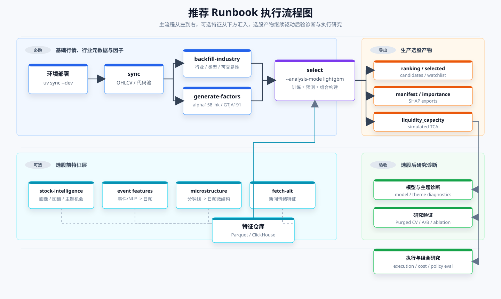

# 港股 / A 股量化研究与回测工具

基于 `ClickHouse + Parquet` 的本地量化研究工具箱，支持港股生产选股、A 股数据补全、因子生成、LightGBM 排序选股、行业分层候选池、组合回测和 Web 看板。

使用手册、当前规划和历史归档见 [docs/README.md](./docs/README.md)。

## 环境部署

```bash
uv run python scripts/setup_environment.py
```

环境安装、服务配置和检查结果说明见 [环境部署与检查](./docs/runbooks/environment-setup.md)。

A 股日 K、分时、基本面、另类数据、覆盖率报告与训练门禁见 [A 股数据分层与训练门禁](./docs/runbooks/cn-data-pipeline.md)。

## 推荐 Runbook

README 以依赖顺序组织流程：基础行情、行业元数据和因子是生产选股硬依赖；画像、事件、微结构、新闻情绪是选股前可选特征层；模型诊断、TCA、执行模拟和组合策略评估都消费 `select` 的导出结果。港股链路是当前生产选股主路径；A 股链路先按腾讯、AkShare 新浪、BaoStock、东方财富的顺序补齐日线数据，再用 `--market CN` 生成因子、LightGBM 排序选股和研究回测。基础标签流水线已经退出推荐流程；LightRAG 只用于 evidence 索引和重点股票深挖，不作为全市场逐股在线问答引擎。

```text
基础数据:
  sync -> backfill-industry
       -> generate-factors

A 股选股:
  sync-cn -> refresh-cn-stock-info
          -> refresh-cn-financial-metrics
          -> backfill-cn-industry
          -> generate-factors --market CN
          -> select --market CN --analysis-mode lightgbm

选股前可选特征层:
  stock-intelligence-pipeline -> theme_opportunity features
  export-event-features -> event_daily features
  export-microstructure-features -> intraday_microstructure features
  fetch-alt -> alt_sentiment features

生产选股:
  select --analysis-mode lightgbm
    -> ranking / selected / candidates / watchlist
    -> liquidity_capacity / simulated TCA
    -> LightGBM manifest / feature importance / SHAP exports

选股后研究诊断:
  lightgbm-model-diagnostics / theme-feature-diagnostics
  lightgbm-abtest / theme-ablation / lightgbm-purged-cv-report
  execution-simulate / fit-execution-cost-model / portfolio-policy-eval
```

### 执行流程图



| 场景 | 前置依赖 | 跑什么 | 频率 |
|---|---|---|---|
| 第一次部署 | 无 | `uv sync --dev`，可选部署 ClickHouse、SearXNG、LightRAG | 只跑一次 |
| 第一次建库或行情更新 | 无 | `sync` | 初次全量，之后按交易日增量 |
| A 股第一次建库或行情更新 | 无 | `sync-cn` | 初次全量，之后按交易日增量 |
| 财务/流动性快照刷新 | `sync` 产生代码池 | `refresh-stock-info` | 每个交易日收盘后，或选股前 |
| A 股财务/流动性快照刷新 | `sync-cn` 产生代码池 | `refresh-cn-stock-info` | 每个交易日收盘后，或回测前 |
| 财务因子面板刷新 | `refresh-stock-info` 已落库 | `refresh-financial-metrics`、`financial-coverage` | 每个交易日收盘后，或财务数据更新后 |
| A 股估值/财务面板刷新 | `refresh-cn-stock-info` 已落库 | `refresh-cn-financial-metrics`、`cn-coverage-check` | 每个交易日收盘后，或财务数据更新后 |
| 行业、标的类型、可交易性刷新 | `sync` 产生代码池 | `backfill-industry`、`industry-coverage` | 新股票或元数据过期时 |
| A 股行业刷新 | `sync-cn` 产生代码池 | `backfill-cn-industry`、`cn-coverage-check` | 新股票或元数据过期时 |
| 因子刷新 | `sync` 产生 OHLCV | `generate-factors --factor-set alpha_zoo_hk` | 每次重训/选股前 |
| A 股因子刷新 | `sync-cn` 产生 CN OHLCV，建议先过 `cn-coverage-check` | `generate-factors --market CN --factor-set alpha_zoo_hk` | 每次重训/选股前 |
| 智能画像/主题特征刷新 | SearXNG、LightRAG、别名/evidence | `stock-intelligence-pipeline --import-to-warehouse` | 按周/月，或研究主题变化时 |
| 事件/微结构实验特征 | 外部事件 CSV 或分钟线 CSV | `export-event-features`、`export-microstructure-features`，再接入特征仓库 | 研究需要时，在 `select` 前 |
| 生产选股 | `sync`、`refresh-stock-info`、`generate-factors`；强烈建议先 `backfill-industry`；可叠加特征层 | `select --analysis-mode lightgbm --export-csv output/results` | 每次要出组合 |
| A 股研究选股 | `sync-cn`、`refresh-cn-stock-info`、`refresh-cn-financial-metrics`、`backfill-cn-industry`、`generate-factors --market CN` | `select --market CN --analysis-mode lightgbm --export-csv output/results_cn` | 每次要出 A 股研究组合 |
| 选股后验收 | `select` 导出的 ranking/selected/feature artifacts | `lightgbm-model-diagnostics`、`theme-feature-diagnostics`、Purged CV、A/B、TCA/RL | 每次模型或特征变化后 |

### A 股一键流水线

```bash
uv run python scripts/run_cn_pipeline.py
```

分层阶段、单独重跑、覆盖率报告、训练门禁和 A 股另类数据接入要求见 [A 股数据分层与训练门禁](./docs/runbooks/cn-data-pipeline.md)。

### 港股日常选股

```bash
uv run python run.py sync --start-date 2014-01-01 --frequencies daily --skip-existing --max-workers 24 --show-progress
uv run python run.py refresh-stock-info --max-workers 16 --show-progress
uv run python run.py refresh-financial-metrics --max-workers 8 --show-progress
uv run python run.py backfill-industry --force --normalize-existing --max-workers 8 --show-progress
uv run python run.py generate-factors --days 365 --factor-set alpha_zoo_hk --max-workers 8 --show-progress
uv run python run.py select \
  --analysis-mode lightgbm \
  --top-n 10 \
  --days 365 \
  --factor-set alpha_zoo_hk \
  --min-market-cap 30 \
  --min-daily-turnover 500 \
  --max-workers 8 \
  --export-csv output/results \
  --show-progress
```

### A 股日常选股

```bash
uv run python run.py sync-cn --start-date 2014-01-01 --frequencies daily --skip-existing --complete-data --max-workers 12 --show-progress
uv run python run.py refresh-cn-stock-info --max-workers 8 --show-progress
uv run python run.py refresh-cn-valuation-history --start-date 2014-01-01 --max-workers 12 --show-progress
uv run python run.py refresh-cn-financial-metrics --max-workers 4 --show-progress
uv run python run.py backfill-cn-industry --show-progress
uv run python run.py generate-factors --market CN --days 365 --factor-set alpha_zoo_hk --max-workers 8 --show-progress
uv run python run.py select \
  --market CN \
  --analysis-mode lightgbm \
  --top-n 10 \
  --days 365 \
  --factor-set alpha_zoo_hk \
  --max-workers 8 \
  --export-csv output/results_cn \
  --show-progress
```

如果要在生成因子前先验收 A 股数据链路，可以在第 4 步后插入：

```bash
uv run python run.py cn-coverage-check --min-ohlcv-rows 120 --json
```

`sync-cn --complete-data` 会在行情同步后继续补齐 `stock_info_registry`、历史日频 `valuation_snapshot`、`financial_statement_metrics` 和行业字段；补全阶段失败会进入 summary，不回滚已经写入的 OHLCV。只想快速补行情时可以去掉 `--complete-data`；只有临时调试需要旧逐股行为时，才额外加 `--include-stock-info`。如果东方财富历史估值接口临时不可达，可以稍后单独重跑 `refresh-cn-valuation-history`，不需要重跑 OHLCV。

当前 `920xxx` 北交所代码暂无稳定免费历史 OHLCV 源：腾讯、AkShare 新浪、东方财富和 BaoStock 均不能稳定返回 2014 至今的标准日线数据，BaoStock 对 `bj.*` 历史查询也会报不支持。因此 `sync-cn` 会先过滤这批代码，并在 summary 输出 `unsupported_count` / `unsupported_codes`；A 股因子、选股和回测暂以沪深主板、创业板、科创板及可获取日线的标的为覆盖口径。后续接入北交所专用历史行情源后，再恢复 `920xxx`。

小样本先跑指定股票，确认腾讯优先链路、AkShare 新浪/BaoStock/东方财富兜底、仓库写入、因子落库和选股都通：

```bash
uv run python run.py sync-cn --stock-codes 600000.SH 000001.SZ --start-date 2020-01-01 --frequencies daily --complete-data --max-workers 2 --show-progress
uv run python run.py refresh-cn-stock-info --stock-codes 600000.SH 000001.SZ --max-workers 2 --show-progress
uv run python run.py refresh-cn-valuation-history --stock-codes 600000.SH 000001.SZ --start-date 2020-01-01 --max-workers 2 --show-progress
uv run python run.py refresh-cn-financial-metrics --stock-codes 600000.SH 000001.SZ --max-workers 2 --show-progress
uv run python run.py backfill-cn-industry --stock-codes 600000.SH 000001.SZ --show-progress
uv run python run.py generate-factors --market CN --stock-codes 600000.SH 000001.SZ --days 365 --factor-set alpha_zoo_hk --max-workers 2 --show-progress
uv run python run.py select --market CN --analysis-mode lightgbm --stock-codes 600000.SH 000001.SZ --top-n 2 --days 365 --factor-set alpha_zoo_hk --max-workers 2 --export-csv output/results_cn_smoke --show-progress
```

小样本验链路同样可以在第 4 步后插入：

```bash
uv run python run.py cn-coverage-check --stock-codes 600000.SH 000001.SZ --min-ohlcv-rows 120 --json
```

`select --analysis-mode lightgbm` 会在单次命令内训练和预测，不依赖 `validate-factors`。生产默认 `--factor-set alpha_zoo_hk`、`--model-objective regression_csrank`、`industry_size` 中性化；`lambdarank` 和 `rank_xendcg` 只作为对照实验。只有旧的 `select --analysis-mode factor` 才需要先跑 `validate-factors`。

`refresh-stock-info` 会把 PB、PE、市值、成交额、成交量、总股本、流通股本、股息率和换手率等当前快照写入 `stock_info_registry`。换手率字段有原始数据时直接入库；缺失时按 `成交量 / 流通股本 * 100` 换算后入库。`refresh-cn-valuation-history` 会把东方财富历史日线中能稳定取得的成交额、换手率，以及源数据存在时的 PE/PB，按 `trade_date + stock_code` 写入 `valuation_snapshot`；字段缺失时留空，不用今天的估值回填过去。生产选股默认优先使用仓库里的财务/流动性快照做流动性过滤和 LightGBM 估值评分，不再临时抓 live 数据；仅当显式设置 `ALLOW_LIVE_MARKET_FILTER_FETCH=1` 时，市场过滤才会对缺失股票启用实时兜底。

`refresh-financial-metrics` 会把本地 `stock_info_registry` 的当前估值/流动性字段转存成当日 `valuation_snapshot`，并写入 `financial_statement_metrics` 的 PIT 财务面板；`financial-coverage` 用于检查字段覆盖率。因子目录已支持 `factor-list`、`factor-show`、`factor-manifest`，生产默认 `alpha_zoo_hk` 包含 `alpha101`、`academic_hk`、`valuation_hk`、`financial_quality_hk` 和 `financial_cross_section_hk`。其中 `financial_cross_section_hk` 会生成 `pe_ind_pct`、`pb_ind_pct`、`roe_ind_pct`、`quality_value_score` 等行业相对财务因子。这些实现只参考 Alpha Zoo 的组织形态，代码、公式代理、manifest 和落库流程都在本项目内原生实现，不读取、不导入、也不要求存在 `Vibe-Trading/` 目录。

`select --export-csv output/results` 会同时导出排名、持仓、候选池、观察名单、行业归因、流动性容量、模拟 TCA、模型 manifest、特征重要性和 SHAP 解释文件。后续诊断、成本模型和组合策略评估都应消费这些产物，不要反向依赖选股前的原始特征文件。

### A 股回测入口说明

A 股日线基础行情默认优先使用腾讯，再回退 AkShare 新浪、BaoStock，最后才短超时回退东方财富；分钟线继续走 AkShare/Eastmoney。OHLCV clean 层会保留可得的 `amount`、`turnover` 和 `vwap`，历史估值/流动性单独落在 `valuation_snapshot`。A 股流程先把 `CN` 分区的数据补齐，再用 `cn-coverage-check` 判断是否达到回测条件。`920xxx` 北交所代码当前会被 `sync-cn` 过滤，不计入历史 OHLCV 回测覆盖。只有明确要压测或排查 BaoStock 时，才给 `sync-cn` 显式加 `--data-source baostock`；只有明确要排查东方财富时，才显式加 `--data-source eastmoney`。

`sync-cn` 会给 AkShare 内部未显式设置 timeout 的 HTTP 请求补默认超时，避免坏 IP 把尾部股票长时间挂在 `SYN-SENT`。默认 `CN_SYNC_SOCKET_TIMEOUT=5` 秒；网络较差时可以调大，想更快跳过坏连接时可以调小，例如：

```bash
CN_SYNC_SOCKET_TIMEOUT=3 uv run python run.py sync-cn --start-date 2014-01-01 --frequencies daily --skip-existing --complete-data --max-workers 24 --show-progress
```

A 股 OHLCV 同步会按完成结果分批落库，默认每 `64` 只股票或 `250000` 行 flush 一次，避免全市场数据全部堆在内存里等最后才写。需要更频繁看到数据库增长时可以调小 `CN_SYNC_FLUSH_STOCKS` 或 `CN_SYNC_FLUSH_ROWS`：

```bash
CN_SYNC_SOCKET_TIMEOUT=3 CN_SYNC_FLUSH_STOCKS=32 uv run python run.py sync-cn --start-date 2014-01-01 --frequencies daily --skip-existing --complete-data --max-workers 24 --show-progress
```

A 股历史估值/流动性补全默认每 `250000` 行 flush 一次，可通过 `CN_VALUATION_HISTORY_FLUSH_ROWS` 调整：

```bash
CN_VALUATION_HISTORY_FLUSH_ROWS=100000 uv run python run.py refresh-cn-valuation-history --start-date 2014-01-01 --max-workers 24 --show-progress
```

`sync-cn --show-progress` 的进度条会显示最近完成的股票和来源简写，例如 `last=600000.SH:tx`，并累计来源分布 `src=tx:92,sn:31,bs:5,em:0`。简写含义：`tx` 腾讯，`sn` 新浪，`bs` BaoStock，`em` 东方财富。

`cn-coverage-check` 会检查 A 股股票池、`daily/qfq` OHLCV、`stock_info_registry`、行业字段、`valuation_snapshot`、`financial_statement_metrics`、feature 层以及 `StockAnalyzer(market="CN")` 的样本读取结果。报告里的 `backtest_ready` 为 `false` 时，先看 `blocking_reasons`；常见阻断包括 `cn_universe_empty`、`cn_ohlcv_rows_below_threshold` 和 `stock_analyzer_cn_load_failed`。

小样本调试时可以指定股票池，避免首次直接全市场跑：

```bash
uv run python run.py sync-cn \
  --stock-codes 600000.SH 000001.SZ \
  --start-date 2020-01-01 \
  --frequencies daily \
  --max-workers 2 \
  --show-progress

uv run python run.py cn-coverage-check \
  --stock-codes 600000.SH 000001.SZ \
  --min-ohlcv-rows 120 \
  --json
```

`generate-factors` 和 `select` 默认市场仍是 `HK`；A 股需要显式加 `--market CN`。如需在 notebook 或脚本里做更细的研究回测，也可以直接构造 `StockAnalyzer(market="CN")`：

```python
from core import StockAnalyzer

analyzer = StockAnalyzer(market="CN")
try:
    result = analyzer.backtest_portfolio(
        stock_codes=["600000.SH", "000001.SZ"],
        days=365,
        top_n=2,
        analysis_mode="lightgbm",
        factor_set="alpha_zoo_hk",
        max_workers=2,
        show_progress=True,
    )
finally:
    analyzer.close()
```

默认情况下，本地设置 `CLICKHOUSE_HOST` 时，日线可以使用 ClickHouse 加速；CN 日线在 2026-09-24 完成 Parquet 切换后，`assets/data/meta/cn_daily_parquet_authoritative.json` 使 CN 日 K 的读写只走 Parquet。下面是对尚未迁入的日期执行切换时使用的模板，输出目录每次必须是新目录：

```bash
uv run python scripts/migrate_cn_daily_clickhouse_to_parquet.py \
  --start-date 2026-09-23 --end-date 2026-09-23 \
  --output-dir output/verification/cn_daily_parquet_cutover_dry_YYYYMMDD

uv run python scripts/migrate_cn_daily_clickhouse_to_parquet.py \
  --start-date 2026-09-23 --end-date 2026-09-23 --publish \
  --output-dir output/verification/cn_daily_parquet_cutover_publish_YYYYMMDD
```

只想检查本地 Parquet 时，也可以临时清掉 ClickHouse 环境变量：

```bash
env -u CLICKHOUSE_HOST -u CLICKHOUSE_PORT -u CLICKHOUSE_HTTP_PORT \
  uv run python run.py cn-coverage-check --limit 20 --json
```

### 国泰君安 191 因子

生产默认使用更完整的 `alpha_zoo_hk`。它包含 `alpha158_hk`，并额外加入 `alpha101`、`academic_hk`、`valuation_hk`、`financial_quality_hk` 和 `financial_cross_section_hk`；`alpha158_hk` 继续保留为轻量回退包，适合小样本调试或需要更快生成因子时使用。`alpha158_hk` 本身已经合并国泰君安 191 因子，输出中会同时包含 Qlib Alpha158、9 个港股定制因子，以及 `GTJA001` 到 `GTJA191`：

```bash
uv run python run.py generate-factors \
  --days 365 \
  --factor-set alpha_zoo_hk \
  --max-workers 8 \
  --show-progress

uv run python run.py factor-report \
  --days 365 \
  --factor-set alpha_zoo_hk \
  --export-csv output/factor_report_alpha_zoo_hk \
  --show-progress

uv run python run.py select \
  --analysis-mode lightgbm \
  --top-n 10 \
  --days 365 \
  --factor-set alpha_zoo_hk \
  --max-workers 8 \
  --export-csv output/results \
  --show-progress
```

如需单独评估 GTJA191 的边际贡献，可以临时使用 `--factor-set gtja_alpha191` 跑 `factor-report` 或小样本对照。注意：原始 GTJA191 中的 `RANK(x)` 是横截面排名，本项目当前因子物化是单股 OHLCV 流式计算，因此内置实现用滚动时序百分位做代理，并在 metadata 中标明。建议让 LightGBM 做特征选择，不建议把 191 个因子等权用于 factor 模式。

### 智能画像/主题特征刷新

```bash
uv run python run.py stock-intelligence-pipeline \
  --searxng-url http://127.0.0.1:8888 \
  --lightrag-url http://127.0.0.1:9621 \
  --engines bing,duckduckgo \
  --max-workers 8 \
  --query-workers-per-stock 2 \
  --profile-stage skip \
  --import-to-warehouse \
  --show-progress
```

默认不需要手动指定 `--theme` 或 `--stock-codes`：股票池从 deep evidence/本地股票 registry 自动识别，主题从图谱节点、别名和 evidence 自动发现。`--profile-stage skip` 是全市场生产默认值，会跳过昂贵的逐股 LightRAG 问答，直接用 evidence/别名/规则图谱生成选股特征；专项研究才加 `--themes 大模型 推理算力 机器人`，小样本调试才加 `--stock-codes 02513`。

生产刷新不要加 `--top-n`。流水线默认对每个主题输出全市场股票分数，用于 LightGBM 特征生产；`--top-n` 只适合临时调试或生成报告榜单。若生产时加了 `--top-n 100`，主题特征会被截断成每个主题只覆盖前 100 只，最终大部分股票画像分为 0，选股收益很难真实受益。

LightRAG 的合理用法是两段式：

```bash
# 全市场：只做搜索、索引、规则图谱、热度、主题特征，不逐股问答
uv run python run.py stock-intelligence-pipeline \
  --searxng-url http://127.0.0.1:8888 \
  --lightrag-url http://127.0.0.1:9621 \
  --engines bing,duckduckgo \
  --profile-stage skip \
  --import-to-warehouse \
  --show-progress

# 重点股票：对少量候选做 LightRAG 深挖画像
uv run python run.py stock-intelligence-pipeline \
  --lightrag-url http://127.0.0.1:9621 \
  --skip-aliases \
  --skip-research \
  --skip-lightrag-index \
  --stock-codes 02513 00700 \
  --profile-stage full \
  --profile-workers 2 \
  --profile-query-workers 3 \
  --top-k 20 \
  --chunk-top-k 10 \
  --show-progress
```

画像特征进入 LightGBM 训练面板默认开启；最终排名 overlay 默认关闭。确认主题特征 OOS 有效后，再用小权重打开：

```bash
uv run python run.py select \
  --analysis-mode lightgbm \
  --top-n 10 \
  --days 365 \
  --factor-set alpha_zoo_hk \
  --theme-feature-set theme_opportunity \
  --theme-overlay-strength 0.05 \
  --export-csv output/results \
  --show-progress
```

`--theme-overlay-strength` 建议从 `0.05` 起步，最高通常不超过 `0.10-0.15`；主题分只做增强和解释，不应压过价格、质量、风险主信号。

跑完选股后，用诊断命令检查智能画像是否真的贡献了有效覆盖，而不是只生成了空特征：

```bash
uv run python run.py lightgbm-model-diagnostics \
  --ranking-csv output/results_alpha_zoo_hk_ranking.csv \
  --selected-csv output/results_alpha_zoo_hk_selected.csv \
  --output-json output/lightgbm_model_diagnostics.json

uv run python run.py theme-feature-diagnostics \
  --ranking-csv output/results_alpha_zoo_hk_ranking.csv \
  --selected-csv output/results_alpha_zoo_hk_selected.csv \
  --theme-feature-csv output/theme_opportunity_features.csv
```

`lightgbm-model-diagnostics` 重点看 `selected_high_chase_rate`、`selected_60d_multibagger_rate`、`selected_120d_multibagger_rate`、`selected_near_52w_high_rate` 和 `selected_high_chase_stocks`。如果持仓里出现过去 60/120 日翻倍、接近 52 周高点且 `high_chase_score` 很高的股票，这不是“正常强势”，而是追高红旗；应先确认是否被 `eligibility_reasons` 拦截，并用中性化/特征家族/主题 ablation 查模型是不是被短期动量主导。

重点看 `theme_feature_stock_coverage_rate`、`theme_opportunity_score` 的 `non_zero_rate`、高分桶平均收益、持仓里 `non_zero` 的数量，以及主题分质量里的 `high_score_zero_relevance_rate`。若 `avg_stocks_per_feature_name` 接近 100 且覆盖率很低，通常是生产命令误加了 `--top-n`，先不带 `--top-n` 重跑智能画像特征；若 `high_score_zero_relevance_rate` 偏高，说明旧主题分被泛热度/泛证据顶高，需要用相关性闸门版本重跑主题分；若全量输出后非零覆盖仍低于 20%，再扩大主题体系或补充行业主题；若高分桶没有更高胜率，不要提高 overlay 权重。

选股导出文件语义：

| 文件 | 含义 |
|---|---|
| `*_ranking.csv` | 全市场排名和解释字段 |
| `*_selected.csv` | 最终当前持仓，只包含 `selected=True` |
| `*_candidates.csv` | 进入组合构建但未最终持有的候选 |
| `*_watchlist.csv` | 观察名单/弱信号/被风控降级的标的 |

## 数据与存储

默认写入本地 Parquet：

| 数据 | 路径 |
|---|---|
| OHLCV | `assets/data/clean/ohlcv` |
| 股票元数据 | `assets/data/meta/stock_info_registry` |
| 信号批次 | `assets/data/signal` |
| 回测交易 | `assets/data/trade` |
| ClickHouse 数据卷 | `assets/clickhouse` |

ClickHouse 是可选加速后端，部署方式和写入分块配置见上面的环境部署章节。未设置 `CLICKHOUSE_HOST` 时项目只使用本地 Parquet。

### 百度网盘数据备份/恢复

换机器或重建环境时，不需要重新同步一遍历史数据。先把百度网盘应用凭证放到环境变量里，不要写入仓库：

```bash
export BAIDU_PAN_APP_ID="..."
export BAIDU_PAN_APP_KEY="..."
export BAIDU_PAN_SECRET_KEY="..."
export BAIDU_PAN_SIGN_KEY="..."
```

上传当前数据快照：

```bash
uv run python run.py data-backup-upload --name stock-data-$(date +%Y%m%d) --show-progress
```

在新环境下载并恢复最新快照：

```bash
uv run python run.py data-backup-download --latest --show-progress
```

上传默认会打包 `assets/data`，并在 `assets/clickhouse` 存在时一起打包 ClickHouse 数据卷，避免只存在 ClickHouse 后端的数据丢失。备份包超过 2GB 时会自动生成 `*.tar.gz.part001`、`*.tar.gz.part002` 等分卷，并上传 `*.manifest.json`；下载时会按 manifest 拉取全部分卷、校验 sha256、合并成原始 `.tar.gz` 后再解压。需要调整分卷大小时可在上传命令加 `--split-size-gb 3`。

第一次运行需要完成一次百度 OAuth 设备授权；授权后的 token 会缓存在 `~/.config/stock_analysis_by_gpt/baidu_pan_token.json`，后续上传/下载会自动刷新。

## 行业分层选股

`backfill-industry` 依赖 `sync` 产生的港股代码池，不依赖因子生成。它会写入：

| 字段 | 用途 |
|---|---|
| `industry_l1/l2/l3` | 真实行业分类、行业内 TopN、覆盖率检查 |
| `instrument_type` | `common_stock` / `fund_like` / `reit` 等标的类型 |
| `is_fund_like` | 硬排除 ETF、基金、REIT、杠杆反向、结构化产品 |
| `tradable_flag` | 停牌或不可交易标的硬过滤 |

覆盖率优先看普通股口径：

如果当前网络环境无法从公开接口拿到行业信息，可以先准备与 `docs/hk_industry_registry.csv` 同格式的本地 CSV，再导入到同一个 `stock_info_registry`：

```bash
uv run python run.py backfill-industry \
  --industry-registry-csv docs/hk_industry_registry.csv \
  --normalize-existing \
  --show-progress
```

导入模式不会访问网络，CSV 中的 `stock_code`、`industry_l1`、`industry_l2`、`industry_source`、`instrument_type`、`is_fund_like`、`tradable_flag` 等字段会写入 registry；已有价格、市值、估值等非空字段会保留。

```bash
uv run python run.py industry-coverage --show-missing
```

重点指标是 `ordinary_l1_rate` / `ordinary_l2_rate`。港股 `03/09/28/30/31/34/72/73/75/77` 等代码段大量是 ETF、基金、杠杆反向或结构化产品，会被统计为 fund-like，不应按普通股票要求行业覆盖。

## 股票智能画像 Registry

行业表用于稳定分层；股票智能画像用于更细的主题、资源、产业链和业务关联。主流程使用 LightRAG-first 画像系统，不再依赖基础标签流水线。

| 文件 | 用途 |
|---|---|
| `docs/hk_entity_alias_registry.csv` | 股票别名、英文名、产品名和模型名，用于深度画像检索 |
| `docs/hk_stock_deep_evidence.csv` | source-aware 深度画像 evidence |
| `docs/hk_stock_profile.csv` | 股票画像摘要和结构化 JSON |
| `docs/hk_stock_deep_tag_registry.csv` | 产品/技术/催化/瓶颈等细分标签 |
| `docs/hk_stock_graph_nodes.csv` / `docs/hk_stock_graph_edges.csv` | 股票画像图谱节点和边 |

批量生成的单股画像报告、LightRAG context、临时图谱 CSV 和主题评分默认写入已忽略的 `output/`，不要提交到 `docs/`。`docs/` 只保留设计文档、小型 registry 和可复现命令；上千只股票的结构化结果应导入 Parquet/ClickHouse 仓库，可读报告和大 JSON 作为本地 artifact 保存在 `output/stock_profiles/HK/<stock_code>/`。

### 最优整合画像流水线

这是推荐主流程。它把别名、source-aware 搜索、LightRAG 索引/召回、强 schema 图谱、热度、主题机会分、LightGBM 标准特征串在一条命令里。DeepSeek 不再对每只股票做基础 tag 抽取，只在 LightRAG 服务内部用于文档索引/图谱抽取和必要召回，因此比 `extract-stock-tags-llm` 全量逐股抽 tag 更省 token，也更容易复用历史索引。

SearXNG 部署见 `docs/done/P0_03_searxng_search_integration.md`，LightRAG 部署见 `docs/done/P0_02_lightrag_deployment.md`。

全市场建议分两段：先全量搜索和索引，再按 `--profile-limit` 或候选池分批做画像召回。不要直接对 3000+ 只股票一次性做多维画像召回。

```bash
uv run python run.py stock-intelligence-pipeline \
  --searxng-url http://127.0.0.1:8888 \
  --lightrag-url http://127.0.0.1:9621 \
  --engines bing,duckduckgo \
  --max-workers 8 \
  --query-workers-per-stock 2 \
  --skip-profile-contexts \
  --skip-graph \
  --skip-enrich \
  --skip-attention \
  --skip-theme \
  --show-progress

uv run python run.py stock-intelligence-pipeline \
  --profile-limit 200 \
  --skip-aliases \
  --skip-research \
  --skip-lightrag-index \
  --lightrag-url http://127.0.0.1:9621 \
  --import-to-warehouse \
  --show-progress
```

小样本调试或专项研究才显式指定股票/主题：

```bash
uv run python run.py stock-intelligence-pipeline \
  --stock-codes 02513 00700 03690 \
  --themes 大模型 推理算力 机器人 \
  --skip-aliases \
  --skip-research \
  --skip-lightrag-index \
  --lightrag-url http://127.0.0.1:9621 \
  --import-to-warehouse \
  --show-progress
```

这条命令生成的核心文件：

| 输出 | 用途 |
|---|---|
| `docs/hk_stock_deep_evidence.csv` | source-aware 深度 evidence，支持断点续跑 |
| `output/stock_profiles/HK/<code>/lightrag_profile_contexts.json` | 单股多维 LightRAG context |
| `output/stock_profiles/HK/<code>/graph_nodes.csv` / `graph_edges.csv` | 单股强 schema 图谱 |
| `output/stock_profiles/HK/graph_nodes_enriched.csv` / `graph_edges_enriched.csv` | 批量增强图谱 |
| `output/attention_signal.csv` | 热度/关注度信号 |
| `output/theme_opportunities.csv` | 主题机会分 |
| `output/theme_opportunity_features.csv` | LightGBM 可读取的 `theme_opportunity` 标准特征 |

### 手动拆分调试命令

下面这些命令只用于排错、单步验证和性能调参。生产优先使用 `stock-intelligence-pipeline` 聚合命令。

| 步骤 | 命令 |
|---|---|
| 别名 | `build-stock-entity-aliases` / `expand-stock-entity-aliases` |
| 搜索 | `research-stock-deep-profile` |
| RAG 索引与召回 | `lightrag-index-evidence` / `lightrag-retrieve-profile-contexts` |
| 图谱转换与增强 | `lightrag-context-to-stock-graph` / `enrich-supply-chain-graph` |
| 热度与主题分 | `derive-attention-signals` / `rank-theme-opportunities` |
| LightGBM 特征 | `export-theme-score-features` |

单只股票排错示例：

```bash
uv run python run.py lightrag-retrieve-profile-contexts 02513 --lightrag-url http://127.0.0.1:9621 --show-progress
uv run python run.py lightrag-context-to-stock-graph 02513 --context-json output/stock_profiles/HK/02513/lightrag_profile_contexts.json
uv run python run.py stock-subgraph 02513 --node-csv output/stock_profiles/HK/02513/graph_nodes.csv --edge-csv output/stock_profiles/HK/02513/graph_edges.csv --json
```

`rank-theme-opportunities` 输出的是可回测/可选股的结构化分数，包含技术、商业化、产业链、瓶颈、催化、热度、证据质量、流动性、趋势、风险和拥挤度组件。外部 Twitter/GitHub/HuggingFace/公众号 API 后续只需要补充写入同一张 `attention_signal` 表，排序器会自动接入。

LightGBM 选股默认会读取 `theme_opportunity` 标准特征进入训练面板；最终排名 overlay 默认关闭。确认主题特征 OOS 有效后，可以用小权重打开：

```bash
uv run python run.py select \
  --analysis-mode lightgbm \
  --factor-set alpha_zoo_hk \
  --theme-feature-set theme_opportunity \
  --theme-overlay-strength 0.05 \
  --top-n 10 \
  --days 365 \
  --export-csv output/results
```

建议 `--theme-overlay-strength` 从 `0.05` 起步，最高不超过 `0.10-0.15`；主题分负责增强召回和排序，不应压过 LightGBM 的价格/质量/风险主信号。

不走 LightRAG 时，`extract-stock-profile-llm` 仍可作为实验性兜底，但不再是推荐主流程。

### 搜索兜底

主流程优先使用本地免费的 SearXNG。Tavily 仅作为付费/额度兜底，Playwright 仅用于小样本诊断或疑难补查；如果改用这些 evidence 文件，把它们作为 `stock-intelligence-pipeline --evidence-csv` 或 `lightrag-index-evidence --evidence-csv` 的输入。`stock-intelligence-pipeline` 默认跳过已成功缓存的深度 evidence，网络恢复后可以直接续跑。LLM/RAG 低置信输出不会直接覆盖最终选股信号，必须先进入强 schema 图谱、热度和主题机会分。

## 验证顺序

改动行业数据、硬过滤、组合选择或画像特征后，先跑小样本 smoke，再跑全市场。

```bash
uv run pytest test/test_portfolio_builder.py -q

uv run python run.py backfill-industry \
  --stock-codes 00700 00005 00941 01299 03690 \
  --force \
  --normalize-existing \
  --show-progress

uv run python run.py select \
  --analysis-mode lightgbm \
  --stock-limit 50 \
  --top-n 3 \
  --days 365 \
  --factor-set alpha_zoo_hk \
  --export-csv output/industry_smoke \
  --show-progress
```

小样本通过后再跑全市场：

```bash
uv run python run.py backfill-industry \
  --force \
  --normalize-existing \
  --max-workers 8 \
  --show-progress

uv run python run.py industry-coverage --show-missing

uv run python run.py select \
  --analysis-mode lightgbm \
  --top-n 10 \
  --days 365 \
  --factor-set alpha_zoo_hk \
  --min-market-cap 30 \
  --min-daily-turnover 500 \
  --max-workers 8 \
  --export-csv output/results \
  --llm-report \
  --show-progress
```

全市场重点检查：

| 文件 | 检查项 |
|---|---|
| `output/results_alpha_zoo_hk_ranking.csv` | 包含 `selection_eligible`、`eligibility_reasons`、`industry_rank`、`industry_score`、`industry_cap` |
| `output/results_alpha_zoo_hk_selected.csv` | 全部 `selection_eligible=True` 且 `industry_rank <= industry_cap`；重点检查 `high_chase_score`、`price_return_60d_pct`、`price_return_120d_pct` |
| `output/results_alpha_zoo_hk_industry_weights.csv` | 行业权重、预算和 HHI 是否过度集中 |
| `output/results_alpha_zoo_hk_industry_attribution.csv` | 行业内 Alpha、行业机会分、Hot/Cold bucket、OOS gate |
| `docs/report/{日期}_llm.md` | 入选/剔除理由是否能解释行业、质量、估值、流动性 |

行业 Core/Overlay AB test 可按需跑：

```bash
# Core：只做行业内选股，推荐作为基准
uv run python run.py select \
  --analysis-mode lightgbm \
  --top-n 10 \
  --days 365 \
  --factor-set alpha_zoo_hk \
  --industry-selection-mode core \
  --export-csv output/ab_core \
  --llm-report \
  --show-progress

# Core + Overlay：OOS gate 胜率达标后才加行业预算
uv run python run.py select \
  --analysis-mode lightgbm \
  --top-n 10 \
  --days 365 \
  --factor-set alpha_zoo_hk \
  --industry-selection-mode core_overlay \
  --industry-overlay-strength 0.2 \
  --export-csv output/ab_core_overlay \
  --llm-report \
  --show-progress

# Timing only：研究/压力测试用，不建议作为默认实盘模式
uv run python run.py select \
  --analysis-mode lightgbm \
  --top-n 10 \
  --days 365 \
  --factor-set alpha_zoo_hk \
  --industry-selection-mode timing_only \
  --industry-overlay-strength 1.0 \
  --export-csv output/ab_timing_only \
  --llm-report \
  --show-progress
```

## 命令速查

| 命令 | 依赖 | 用途 |
|---|---|---|
| `sync` | 无 | 拉取 OHLCV，产生代码池 |
| `sync-cn` | 无 | 拉取 A 股 OHLCV，产生 CN 代码池 |
| `refresh-stock-info` | `sync` | 刷新 PB/PE、市值、成交额/成交量、换手率、股本等财务/流动性快照到 `stock_info_registry` |
| `refresh-cn-stock-info` | `sync-cn` | 刷新 A 股 PB/PE、市值、成交额/成交量、换手率、股本等快照到 `stock_info_registry` |
| `refresh-cn-valuation-history` | `sync-cn` | 刷新 A 股历史日频成交额、换手率及可得 PE/PB 到 `valuation_snapshot` |
| `backfill-industry` | `sync` | 补行业、标的类型、fund-like、可交易性 |
| `backfill-cn-industry` | `sync-cn` | 使用 BaoStock 补 A 股行业分类 |
| `refresh-cn-financial-metrics` | `refresh-cn-stock-info` | 刷新 A 股 `valuation_snapshot` 和 `financial_statement_metrics` |
| `cn-coverage-check` | `sync-cn`，建议先刷新 stock info、行业和财务 | 检查 A 股数据链路是否满足本地因子/回测 |
| `generate-factors` | `sync` 或 `sync-cn` 对应市场的 OHLCV | 默认生成 `alpha_zoo_hk`，A 股显式加 `--market CN`，可显式指定 `alpha158_hk` 轻量包 |
| `select --analysis-mode lightgbm` | `sync`/`sync-cn`、stock info、行业、`generate-factors`；A 股显式加 `--market CN` | 推荐选股模式，单次命令内训练和预测 |
| `validate-factors` | `generate-factors` | 仅供 factor 模式选股使用 |
| `select --analysis-mode factor` | `generate-factors`、`validate-factors` | 验证权重驱动的选股模式 |
| `signal-report` | `generate-factors` | 验证信号 recipe 触发后的未来收益 |
| `factor-report` | `generate-factors` | 独立评估因子 IC/RankIC |
| `fetch-alt` | 无 | 可选新闻情感特征，LightGBM 有数据则自动加载 |
| `stock-intelligence-pipeline` | SearXNG、LightRAG、别名表 | 推荐主流程，一条命令生成画像图谱、热度、主题分和 LightGBM 特征 |
| `export-event-features` | 事件/NLP CSV，需 `stock_code` 和 `available_at`/`publish_time`/`event_time`/`event_date` 之一 | 生成 PIT 日频事件特征；如要参与模型，需在 `select` 前接入特征仓库 |
| `export-microstructure-features` | 分钟线/盘中 bars CSV | 聚合日频微结构特征；如要参与模型，需在 `select` 前接入特征仓库 |
| `build-stock-entity-aliases` | `stock_info_registry`、人工别名可选 | 生成股票/公司/产品/模型别名 |
| `expand-stock-entity-aliases` | 深度 evidence、别名表 | 从 evidence 里补产品名、模型名、技术名 |
| `research-stock-deep-profile` | 别名表、本地 SearXNG | 主动检索股票画像/图谱 evidence |
| `lightrag-index-evidence` | 深度 evidence、LightRAG 服务 | 把研究语料写入 LightRAG |
| `lightrag-retrieve-profile-contexts` | LightRAG 索引、别名表 | 多维召回单股/主题画像 context |
| `lightrag-context-to-stock-graph` | LightRAG context | 转成本项目强 schema 图节点/边 |
| `extract-stock-profile-llm` | 深度 evidence、DeepSeek key | 抽取股票画像、deep tags、图谱边 |
| `enrich-supply-chain-graph` | 图节点/边、深度 evidence | 增强产业链、瓶颈、卡点关系 |
| `derive-attention-signals` | evidence、图节点/边 | 生成热度/关注度信号 |
| `rank-theme-opportunities` | 图谱、热度、evidence | 生成主题机会分 |
| `export-theme-score-features` | 主题机会分 | 导出 `theme_opportunity` 标准特征供 LightGBM 读取 |
| `stock-subgraph` | 图节点/边 CSV 或仓库 | 查看某只股票的画像子图 |
| `lightgbm-model-diagnostics` | `select` 导出的 ranking/selected CSV | 模型追高诊断：特征家族重要性、动量暴露、多倍涨幅红旗 |
| `theme-feature-diagnostics` | `select` 导出 + 主题特征 CSV | 主题画像覆盖率、分桶收益、持仓命中诊断 |
| `lightgbm-abtest` | 无（内部调用 `select`） | 中性化模式 A/B 对照：`none` vs `industry` vs `industry_size` |
| `theme-ablation` | 无（内部调用 `select`） | 画像特征 ablation：with/without 主题特征的 OOS 对比 |
| `lightgbm-purged-cv-report` | 带日期、预测分和 forward return 的 ranking/prediction CSV | 生成 Purged CV fold-level 报告，验证研究协议稳定性 |
| `execution-simulate` | 订单参数，可选真实/合成盘中切片 | TWAP/VWAP/POV/IS/AC 执行 baseline 模拟 |
| `fit-execution-cost-model` | simulated/real TCA CSV | 训练/诊断监督式执行成本模型 |
| `portfolio-policy-eval` | ranking/panel CSV，需 `trade_date`、`stock_code`、分数、forward return、成本字段 | 离线评估 expert/imitation 组合 policy |

常用命令模板：

```bash
uv run python run.py sync --start-date 2014-01-01 --frequencies daily --skip-existing --max-workers 24 --show-progress
uv run python run.py backfill-industry --force --normalize-existing --max-workers 8 --show-progress
uv run python run.py generate-factors --days 365 --factor-set alpha_zoo_hk --max-workers 8 --show-progress
uv run python run.py validate-factors --days 365 --factor-set alpha_zoo_hk --export-csv output/validation_scorecard --show-progress
uv run python run.py signal-report --days 365 --signal-recipes low_price_setup,range_breakout,box_pullback --horizons 20,40,60 --export-csv output/signal_report --show-progress
uv run python run.py factor-report --days 365 --factor-set alpha_zoo_hk --export-csv output/factor_report --show-progress
uv run python run.py fetch-alt --stock-limit 100 --persist-signals --show-progress

# A 股日常选股（推荐）
uv run python scripts/run_cn_pipeline.py
```

刚补完行业或 instrument 元数据后，不需要重跑 `sync`，但需要重跑 `select`。生产默认是 `alpha_zoo_hk`；若只是快速调试，可显式指定轻量回退包 `alpha158_hk`。

生成物放置规则：小型 registry 和设计文档可放 `docs/`；上千只股票的报告、LightRAG context、临时图谱、主题评分 CSV 放 `output/`；会参与选股和回测的结构化结果用 `--import-to-warehouse` 写入 Parquet/ClickHouse。

导出文件：

| 文件 | 内容 |
|---|---|
| `{base}_{factor_set}_ranking.csv` | 全市场排名、硬过滤原因、行业排名 |
| `{base}_{factor_set}_selected.csv` | 最终持仓 |
| `{base}_{factor_set}_candidates.csv` | 进入组合构建但未最终持有的候选池 |
| `{base}_{factor_set}_watchlist.csv` | 观察名单 |
| `{base}_{factor_set}_industry_weights.csv` | 组合行业权重 |
| `{base}_{factor_set}_industry_attribution.csv` | 行业 Core/Overlay 归因 |
| `{base}_{factor_set}_liquidity_capacity.csv` | ADV、订单占比、预估滑点/冲击、流动性容量分 |
| `{base}_{factor_set}_tca_simulated_report.csv` | 基于组合 replay 的 simulated TCA，供执行成本模型和 RL reward sanity check 使用 |
| `output/lightgbm_feature_importance.json` | LightGBM 特征重要性 |
| `output/lightgbm_model_manifest.json` | 模型训练配置、特征集、目标函数和数据窗口 manifest |
| `output/stock_shap_contribution.csv` | 最新截面 stock-feature SHAP 长表 |
| `output/portfolio_shap_exposure.csv` | 组合层面按特征家族汇总的 SHAP 暴露 |
| `output/shap_history_latest.json` | 最新 SHAP 历史窗口，可用于漂移检测 |

行业分层字段：

| 字段 | 含义 |
|---|---|
| `industry_l1/l2/l3` | 真实行业分类 |
| `selection_eligible` / `eligibility_reasons` | 硬过滤结果与剔除原因 |
| `industry_rank` / `industry_score` / `industry_cap` | 行业内候选排名、分数和候选上限 |
| `industry_alpha_score` | 行业内个股 Alpha 分，Core 选股底座 |
| `industry_opportunity_score` | 行业 RPS、breadth、波动率合成的 Overlay 机会分 |
| `combined_selection_score` / `selection_layer` | Core+Overlay 后候选分，以及 `core`/`overlay_boosted`/`fallback` |
| `industry_timing_bucket` | `Hot` / `Neutral` / `Cold` / `Broken` |
| `industry_timing_oos_win_rate` / `industry_timing_oos_ir` | 行业机会分相对 OOS/forward-return 代理收益的胜率与 IR |
| `candidate_cap_base` / `candidate_cap_overlay` | 基础候选名额与 Overlay 后候选名额 |
| `industry_weight_budget` / `industry_budget_reason` | 行业权重预算与预算原因 |
| `industry_concentration_penalty` / `final_score` | 行业集中度惩罚和最终分 |
| `quality_data_coverage` / `quality_missing_fields` | 财务质量数据覆盖 |
| `valuation_metric_used` / `valuation_data_coverage` | 行业内估值指标与覆盖 |
| `portfolio_industry_hhi` | selected 组合行业集中度 |
| `portfolio_industry_hhi_invested` | 已投资仓位归一化后的行业集中度，避免现金仓位稀释 HHI |

`Broken` 行业不会进入 selected；如个股本身信号强，会被放入 watchlist 供观察。Overlay 的 OOS gate 当前使用本次可得的 OOS/forward-return 汇总做代理检验，后续如接入完整历史行业轮动 panel，可替换为严格 walk-forward 口径。

## 选股后诊断与研究流程

这些命令按依赖分组使用：事件、微结构和画像特征必须在 `select` 前准备；模型诊断、Purged CV、TCA、执行成本模型和组合 policy 评估都在 `select` 导出结果之后运行。

```bash
# A. 选股前可选特征：文本事件 CSV -> PIT 日频特征
uv run python run.py export-event-features \
  --events-csv output/events.csv \
  --long-format \
  --output-csv output/event_daily_features.csv

# A. 选股前可选特征：分钟线 -> 日频微结构特征
uv run python run.py export-microstructure-features \
  --bars-csv output/minute_bars.csv \
  --long-format \
  --output-csv output/intraday_microstructure_features.csv

# B. 生产选股：自带 manifest、特征重要性、SHAP、流动性容量和模拟 TCA 导出
uv run python run.py select \
  --analysis-mode lightgbm \
  --top-n 10 \
  --days 365 \
  --factor-set alpha_zoo_hk \
  --min-market-cap 30 \
  --min-daily-turnover 500 \
  --max-workers 8 \
  --export-csv output/results \
  --show-progress

# C. 选股后验收：模型追高/动量诊断
uv run python run.py lightgbm-model-diagnostics \
  --ranking-csv output/results_alpha_zoo_hk_ranking.csv \
  --selected-csv output/results_alpha_zoo_hk_selected.csv \
  --feature-importance-json output/lightgbm_feature_importance.json \
  --output-json output/lightgbm_model_diagnostics.json

# C. 选股后验收：主题画像诊断（如果启用了智能画像）
uv run python run.py theme-feature-diagnostics \
  --ranking-csv output/results_alpha_zoo_hk_ranking.csv \
  --selected-csv output/results_alpha_zoo_hk_selected.csv \
  --theme-feature-csv output/theme_opportunity_features.csv \
  --theme-score-csv output/theme_opportunities.csv

# C. 研究协议：Purged CV fold-level 报告
uv run python run.py lightgbm-purged-cv-report \
  --predictions-csv output/results_alpha_zoo_hk_ranking.csv \
  --score-col model_score \
  --target-col forward_return_20 \
  --output-csv output/lightgbm_purged_cv_report.csv \
  --output-json output/lightgbm_purged_cv_summary.json

# D. A/B：中性化模式对照，内部会调用 select
uv run python run.py lightgbm-abtest \
  --compare none,industry,industry_size \
  --days 365 \
  --stock-limit 300 \
  --output-json output/lightgbm_abtest.json

# D. A/B：主题画像 ablation，内部会调用 select
uv run python run.py theme-ablation \
  --days 365 \
  --stock-limit 300 \
  --output-json output/theme_ablation.json

# D. A/B：实验性 LambdaRank 对照
uv run python run.py select \
  --analysis-mode lightgbm \
  --top-n 10 \
  --days 365 \
  --factor-set alpha_zoo_hk \
  --model-objective lambdarank \
  --export-csv output/results_lambdarank \
  --show-progress

# E. 执行层 baseline：TWAP/VWAP/POV/IS/AC 模拟
uv run python run.py execution-simulate \
  --stock-code 00700 \
  --side buy \
  --quantity 10000 \
  --arrival-price 300 \
  --algo pov \
  --max-pov 0.10 \
  --output-csv output/execution_simulated_report.csv

# E. 组合 RL sandbox：expert / imitation policy 离线评估
uv run python run.py portfolio-policy-eval \
  --panel-csv output/results_alpha_zoo_hk_ranking.csv \
  --policy expert \
  --output-json output/portfolio_policy_eval.json

# E. 执行成本模型：simulated/real TCA -> 监督成本模型
uv run python run.py fit-execution-cost-model \
  --tca-csv output/results_alpha_zoo_hk_tca_simulated_report.csv \
  --output-json output/execution_cost_model.json
```

`export-event-features` 和 `export-microstructure-features` 默认只生成 CSV。要让它们参与 LightGBM，需要把 long-format 结果按标准特征口径导入 Parquet/ClickHouse 或接入特征加载链路，然后再跑 `select`。`portfolio-policy-eval` 需要的是多日期 panel；单日 ranking CSV 只适合 CLI smoke，不代表完整离线策略评估。

### 诊断指标验收标准

| 指标 | 目标 | 说明 |
|---|---|---|
| 单一特征家族 gain 占比 | < 35% | momentum/value/volume 等不应一家独大 |
| TopK 追高比例 | < 50% | `selected_high_chase_rate` 不过半 |
| 60 日涨幅 >100% 的持仓比例 | < 30% | `selected_60d_multibagger_rate` 不超标 |
| 接近 52 周高点比例 | < 50% | `selected_near_52w_high_rate` |
| OOS IC / RankIC | 同向为正 | 不能只靠 1-2 个行业贡献 |
| 主题特征贡献 | > 0 或模型自然降权 | `theme_features_zero_contribution` 才需排查 |
| 中性化后 IC | 允许略降但回撤/高位暴露应下降 | 优先实盘稳定性 |
| 成本后排名 | 低成本不等于好股票，但高成本必须扣分 | `cost_adjusted_ranking_score` |
| TCA 模拟成本 | 用于执行 RL 前的 reward sanity check | `*_tca_simulated_report.csv` |

### 模型目标函数对照

| 模式 | CLI 参数 | 适用场景 |
|---|---|---|
| MSE 回归 + CSRankNorm（基线） | `--model-objective regression_csrank` | 生产默认 |
| LambdaRank + date group | `--model-objective lambdarank` | TopK 优化对照 |
| RankXENDCG | `--model-objective rank_xendcg` | 更快收敛的 rank 对照 |

LambdaRank 不是默认替代——应先在 A/B 中确认真实 OOS 提升后再考虑小权重 ensemble。

### 成本感知组合与执行研究

`select --export-csv` 会额外导出：

| 产物 | 说明 |
|---|---|
| `*_liquidity_capacity.csv` | `adv_20d`、`order_size_to_adv`、预估滑点/冲击、流动性容量分 |
| `*_tca_simulated_report.csv` | 基于组合 replay 成交记录生成的 simulated TCA |
| `output/stock_shap_contribution.csv` | LightGBM 最新截面 stock-feature SHAP 长表 |
| `output/portfolio_shap_exposure.csv` | 按特征家族汇总的组合 SHAP 暴露 |
| `output/shap_history_latest.json` | 可接入 `compute_shap_drift` 的 SHAP 历史窗口 |

组合 ranking/selected 中会带 `expected_transaction_cost_bps`、`liquidity_capacity_score` 和 `cost_adjusted_ranking_score`。这些字段是规则组合器和后续 RL 环境的共同接口；真实券商成交回报接入前，TCA 明确标记为 simulated。

## 辅助功能

```bash
# 单股分析 / 策略套件 / 批次复盘 / 旧一体化入口
uv run python run.py single 00700 --days 365
uv run python run.py suite --days 365 --top-n 3
uv run python run.py review hk_top10_20260516 --export-csv output/review
uv run python run.py all --top-n 10 --days 365 --max-workers 8 --show-progress

# LLM 报告：设置密钥后，在 select 加 --llm-report
export DEEPSEEK_API_KEY=...
uv run python run.py select --analysis-mode lightgbm --top-n 10 --days 365 --llm-report
```

## Python API

```python
from core import StockAnalyzer

analyzer = StockAnalyzer(db_dir="./assets")

result = analyzer.backtest_hk_market(
    days=365,
    top_n=10,
    initial_capital=100000,
    max_workers=8,
    analysis_mode="lightgbm",
    factor_set="alpha_zoo_hk",
)
```

## Web 界面

```bash
# 后端
uv run uvicorn backend.main:app --host 0.0.0.0 --port 8000 --reload

# 前端，需要 Bun
cd frontend
bun install
bun run dev
```

生产部署：`cd frontend && bun run build`。FastAPI 会托管 `frontend/dist/`，访问 `http://localhost:8000`。

| 页面 | 路由 | 功能 |
|---|---|---|
| 选股结果 | `/` | 来源 tab + **名单搜索/★自选** + 评分榜 + 同花顺导出（折叠）+ SHAP 归因 |
| 策略池 | `/strategies` | **所有选股策略的登记处**：生产 / 候选中转 / 研究证据，见下节 |
| 因子 IC 分析 | `/factor-ic` | **因子池体检**：按仓库审计口径分级（无效/合格/优质/很强）+ 一键登记候选 |
| K 线图表 | `/kline` | K 线、均线、成交量、信号标记；**点任意一根 K 线看当日分时**；左侧自选股、右侧个股资料 |
| 选股日历 | `/calendar` | 逐日选股台账、来源对照、T+N 前瞻收益；**★自选联动 + 只看自选 + 分析视图 tab** |
| 选股归因 | `/attribution` | 逐股 SHAP + 启动门禁 tilt 拆分 |
| 因子挖掘 | `/factor-mining` | **agent 工作台**（左会话 / 中任务+轨迹 / 右产物），跑完可**一键入池** |
| 数据流水线 | `/pipeline` | 各阶段产物、最近运行、单阶段重跑 |
| 自动化进度 | `/automation` | 每日生产任务的实时日志 |
| 回测绩效 | `/performance` | 净值、回撤、月度收益、交易明细（`/portfolio` 已重定向到此） |
| 模拟盘 | `/paper` | 前向模拟账户持仓与成交 |
| **涨跌/资金排行** | `/rankings` | 每日 / 每周（近 5 日）全市场涨跌幅与资金流排行 |
| **行业热度** | `/industry` | 热度网格 + **股票热力图**（面积=流通市值、颜色=涨跌，行业可下钻）+ 选中行业**自动列出**成分股 |
| **连板统计** | `/limitup` | 一板 / 两板 / 三板 / 四板+ 每日家数、最高板、晋级率 |
| **分时行情** | `/intraday` | 当日 1 / 5 分钟分时 + 均价线，盘中自动刷新 |

#**「自动化跑完 → 所有页面都是最新交易日」怎么保证**（2026-10-10 起）：

```bash
uv run python scripts/audit_web_freshness.py --strict   # 每个页面的数据日期 vs 最新交易日
# → output/data_quality/web_freshness.{json,md}；不达标会写日志 + 触发通知
uv run python scripts/refresh_performance_chain.py      # 回放（4 arm）→ 绩效指标，实测 ~15s
```

| 环节 | 做法 |
|---|---|
| 页面清单 | **17 项**登记在 `audit_web_freshness.py`：选股结果（生产/研究手臂/概念手臂）、选股日历、选股归因、K 线、榜单+行业热度+连板、回测绩效、数据流水线、自动化进度、模拟盘、同花顺导出、个股资料（龙虎榜/概念成分）、分时、因子挖掘 |
| 判定口径 | `eq`：数据日期必须 == 最新交易日；`ge`：按**运行日**命名的产物（流水线报告，跨零点会是次日）；`event/live`：只报告不判死 |
| 每日流程 | 研究数据面 `boards → adj_factor → arm_concept → arm_concept_backtest → **performance（回放+指标）** → lhb → sw2021`；收尾为 **`sync_strategy_pool.py --strict`（策略池）→ `audit_web_freshness.py --strict`**，不达标直接点名并通知 |
| 页面可见 | `/api/freshness` + 「自动化进度」页顶部的 **Web 页面新鲜度**面板（17 行：页面 / 口径 / 数据日期 / 状态 / 读的产物） |
| 守门测试 | `test/test_web_freshness.py`（页面清单覆盖、口径语义、产物与接口一致、回放净值必须推进到最新交易日、脚本接线） |

2026-10-10 实测：体检 **全部达标**（17/17；此前"回测绩效/选股归因"两项落后 —— 归因链的 `ROOT=parents[3]`
与产物目录写错已修，绩效链（回放+基准）已接进每日流程，页面窗口已推进到 2026-10-09）。

**选股日历表格支持按列筛选**（2026-10-10）：明细列表与多策略对比**两张表**都有筛选行 ——
文本列包含匹配（`!x` 取反）、数值列支持 `>0` / `<=2` / `1~3` / `=2.5`、收益与权重按**百分数**填
（所见即所填），另有「入选策略」「来源」下拉、命中行数提示与「清空筛选」。实测 2026-10-08：
策略=行业轮动 28→10 行、T+1 > 0 → 12 行、T+1 <= -2 → 9 行、行业含"银行" → 3 行。

**2026-10-10 修掉的两处"页面没跟到最新日期"**：
| 症状 | 根因 | 处理 |
|---|---|---|
| 选股归因页停在 10-08 | `scripts/explain_selection.py` 的 `ROOT` 写成 `parents[3]`（= `/Users/ccs/code`）→ `import factor_engine` 直接 ModuleNotFoundError；且产物目录用 `Path(__file__).parent`，脚本搬到 `scripts/` 后把 30MB SHAP 明细写进了 `scripts/`，下游 `pick_attribution_report.py` 按约定路径取不到 → FileNotFoundError | ROOT 改 `parents[1]`、新增 `--out-dir` 默认写回 `output/verification/p1_22_shap_attribution_20260925/`；已补跑 10-09，`test/test_calendar_filters_and_fixes.py` 钉住这两点 |
| 回测绩效页窗口不推进 | `scripts/portfolio_performance.py` 从来不在每日流程里 | 新增 `DAILY_PERFORMANCE=1` 步骤（每次数据面之后跑）；注意它读的是 `l3_replay` 的净值 CSV，净值序列本身要靠 `replay_daily_execution.py`（研究口径，另行排期）|

**选股结果 ↔ 选股日历 必须同步**（用户 2026-10-09 报过"结果里有、日历里没有"）：
日历的数据底座是 `output/results_cn/selection_ledger.parquet`，由 `scripts/build_selection_ledger.py`
从各来源的**逐日历史**合并。概念手臂写入 `arm_concept_history/<date>.csv` 后，台账读取器
（`read_arm_concept_history`）把它并进台账、日历来源下拉就是 `arm_concept`。
以后再新增手臂，**三步都要做**：① 写 `<arm>_history/<date>.csv`；② 在台账装配里注册读取器；
③ 前端 `SelectionCalendar.vue` 的 `SOURCE_LABEL / SOURCE_SHORT / SOURCE_LETTER` 三张表补上，
否则会出现"选股结果有、日历没有"或"下拉是英文 key、格子里是乱序字母"。

**三种策略与"每只票是哪种策略选出来的"**（2026-10-09）：台账里按策略分组显示 ——
`模型策略`（`preselected` 候选池 + `notify` PK 后最终名单）、`小市值手臂`（`arm` = arm_select）、
`行业轮动`（`arm_concept` 概念/板块手臂）。选股日历的「多策略对比」有 **入选策略** 列（带颜色标签）
与策略构成汇总（当天每个策略各选出多少只）；后端 `STRATEGY_META` 负责 source→策略映射。

**任意股票代码/名称可点**：全站统一跳 `/#/kline?code=<ts_code>`；日 K 页新增
- **左侧「自选股」侧栏**：本地自选（localStorage，★ 增删）+ 快速分组（概念手臂/研究手臂/生产名单/模拟盘持仓）；
- **右侧「个股资料」面板**（`GET /api/stocks/{code}/bundle`）：概况（含概念/申万/涨停统计/估值）、
  财务（8 期 ROE/毛利率/负债率/EPS/增速）、资金（5/20 日 + 东财/同花顺口径）、龙虎榜（含机构）、
  **选股记录（哪些策略哪一天选过它 + 前瞻收益）**、公告（巨潮，10 分钟缓存）。
  新闻：仓库没有本地新闻源 —— 给东财/同花顺/雪球/巨潮**外站链接**，前端标注"外站"，不假装是本地数据。

**前端在哪看**（如果"刷新了还是看不到"，先看这里）：

| 入口 | 位置 |
|---|---|
| 选股结果页 | 来源 tab 第 3 个 **CN 概念/板块手臂（concept_rotation）**；也支持深链 `/#/?source=cn_arm_concept` |
| 行业热度页 | 右上角入口 **「概念/板块手臂名单 →」** 直达上面那个来源 |
| 流水线页 | tab **概念手臂（concept_rotation）**（含选中概念 + 月频回放摘要） |
| 同花顺导出 | 选股结果页的导出块里单列一组 **arm_concept**（10 只，可直接导入自选股） |
| 导航栏 | 右上角 **`build 10-09 19:29 · DB13K4a6`** —— 一眼确认浏览器跑的是不是最新构建 |

> 2026-10-09 踩坑：功能在内核/命令行/API 都正常，但页面上怎么刷新都不显示 ——
> 根因是 **`/api/*` 响应没有缓存头**，浏览器对无缓存头的 GET 会启发式缓存，
> 来源 tab 一直用着旧的 3 个。现已给全部 `/api/*` 加 `Cache-Control: no-store`，
> 并在 `/health` 与导航栏加了构建戳（同 `test/test_web_cache_and_build.py` 三条契约）。

#### 概念/板块轮动手臂（独立策略项，与 arm_selection 并列）

```bash
uv run python scripts/select_concept_arm.py                    # 生成名单（或走流水线阶段）
uv run python scripts/run_cn_pipeline.py --stage arm_concept    # 每日自动化里的同一条路径
uv run python scripts/select_concept_arm.py --backtest         # 月频回放该规则
```

| 面 | 位置 |
|---|---|
| 阶段 | `run_cn_pipeline.py --stage arm_concept`（配置节 `[arm_concept]`） |
| 产物 | `output/results_cn/arm_concept_selection.{csv,json}`、`arm_concept_history/<date>.csv`、`arm_concept_backtest.json` |
| 选股结果页 | 来源下拉新增 **CN 概念/板块手臂（concept_rotation）**（`selection_sources.SOURCES` 的 `cn_arm_concept`） |
| 流水线页 | 新增 tab **概念手臂（concept_rotation）**（含选中概念与月频回放摘要） |
| 每日自动化 | `DAILY_ARM_CONCEPT=1`（排在 `boards` 之后，因为要用当天刷新的概念成分表） |

信号口径：板块层 `0.5×概念20日动量 + 0.3×资金流强度 − 0.2×涨停密度`（概念来自新浪 175 个板块，
成分表每日刷新）→ 个股层在选中概念内 `0.4×短期反转 + 0.3×资金流 + 0.3×流动性`；
持仓强制单概念 ≤2 只、非 ST(PIT)、非涨停、20 日均成交额 ≥5000 万。

实测（月频回放，2025-01 ~ 2026-09，22 期）：期均 **+3.88%**、全市场等权基准 +2.27%、
超额 **+1.94%/月**、胜率 64%、累计 +101.5%、最大回撤 -21.9%。

**边界**：概念成分表是**当前快照**（无 PIT 历史）→ 回放有前视，属于上界；概念动量近 5 年失效
（后半段 -1.51%/月），弱市里应停用或降权；未建模涨停买不进与冲击成本。

#### 数据体检"未达标"的排查结论（2026-10-09）

体检从 **未达标 5/11 → 0/11**，三项的根因**都不是"Tushare 没有数据"**：

| 体检项 | 表面现象 | 真实根因 | 处理 |
|---|---|---|---|
| `adj_factor` | 目录不存在 | `[relay_data].adjustment_factors_enabled = false` —— **开关从来没开**；relay 的 `adj_factor` 实测可用（`000001.SZ` 2026-10-08 = 142.0699） | 打开开关 + 新增 `scripts/sync_cn_adj_factor.py`（按日全市场 1~2 个请求/日 + 逐股历史小预算），已进每日自动化 |
| `intraday_5min` | "落后 11 只" | 判据用**全市场 as_of** 去卡每只票；这 11 只是停牌/退市（日线与分时都停在同一旧日期） | 判据改为按**个股自己的最后一根日线**比对，停牌票豁免；真实落后 0 只 |
| `financials` | 待补 1 只 | 待补的是 **\*ST萃华(002731.SZ，日线止于 2026-08-31)**，Tushare 上游最新报告期也只到 2025-09-30 —— 公司不再披露 | 判据加"已停止交易则豁免"，仍保留"正常交易的票一只不能漏" |

（"未达标"是**数据体检**的结论，不是 pytest：相关回归 **50 passed**。）

#### 板块/龙虎榜/申万行业数据面（2026-10-09 补齐，已进每日自动化）

```bash
uv run python scripts/sync_cn_boards.py                 # 新浪 行业49/概念175/地域31 板块行情+全量成分；同花顺 90 行业汇总+375 概念名单（实测 79s）
uv run python scripts/sync_cn_lhb.py --days 15          # 龙虎榜明细+机构买卖（按交易日增量，实测 8.6s）
uv run python scripts/sync_cn_sw2021_industry.py        # 申万2021一级行业成分（乐咕限流，每次最多补 8 个，分日补齐）
```

| 产物 | 说明 |
|---|---|
| `assets/data/meta/cn_board_membership.parquet` | 板块成分长表（255 板块 / 19,174 行 / 5,943 只票）——**概念板块研究从此可用** |
| `assets/data/derived/cn_board_daily/taxonomy=*/board_daily.parquet` | 板块日行情（涨跌幅/成交额/净流入/家数/领涨股），按日追加去重 |
| `assets/data/derived/cn_lhb/lhb_daily.parquet` | 龙虎榜长表（含机构买卖、净额占比），只收"已完成交易日" |
| `assets/data/meta/cn_sw2021_industry.parquet` | 申万 2021 一级行业成分（19/31，限流渐进补齐） |

源选型（实测）：东财板块接口走 `push2/api/qt/clist` **本机代理稳定 403**；同花顺成分页 Nginx 403
（hexin-v 反爬）；**新浪可用且最快**（成分 255 个板块 79s），行业资金流口径另取同花顺 `stock_board_industry_summary_ths`。

每日自动化接线（`scripts/run_daily_production.sh`，主阶段之后、非阻塞）：

```
DAILY_BOARDS=1  → run_data_step boards  uv run python scripts/sync_cn_boards.py --session-seconds 900
DAILY_LHB=1     → run_data_step lhb     uv run python scripts/sync_cn_lhb.py --days 15
DAILY_SW2021=1  → run_data_step sw2021  uv run python scripts/sync_cn_sw2021_industry.py --max-per-run 8
```

三个新数据面已进 `scripts/data_completeness_report.py` 的每日体检（板块/龙虎榜 ✅，申万按事件类）。
回归测试 `test/test_board_sync.py` 已加进 `DAILY_PREFLIGHT_CMD`（接线断了会直接卡在预检）。

#### 板块轮动经典文献的复现（J×K 行业动量 / 短期反转）

```bash
uv run python scripts/reproduce_industry_rotation_papers.py --start 2016-01-01 --end 2026-10-08
# → output/research/industry_rotation/reproduce_papers.{md,json}
```

对标文献元数据经 Crossref 核对（MG1999 doi:10.1111/0022-1082.00146；Gong2016 doi:10.2139/ssrn.2724618；
Wu2010 doi:10.1007/s11156-010-0206-z；Li&Yang2018 doi:10.2139/ssrn.3141660；Ackert&Huang2015 doi:10.1016/j.jbef.2015.01.001）。
`--taxonomy` 可选 `tushare_industry` / `sina_concept` / `sina_industry` / `sina_area`。

结论（**概念成分表补齐后已更新**）：
* **行业口径**：动量不复现（全样本最强 t=1.14；2021 年后连方向都翻转），短期反转仅近 5 年显著（t=-2.04，
  且只体现在多空价差上，多头端在等权口径下是亏的）；
* **概念口径（新浪 175 概念，本轮新补的数据）**：**动量可复现** —— 全样本最强 J=1/K=12 = **+2.65%/月
  （NW t=+2.18）**、J=6/K=6 = +2.14%（t=1.52）、J=12/K=6 = +2.32%（t=1.74）；但**动量集中在前半段**
  （前半段 J=1/K=6 +2.50%，t=3.52；后半段 -1.51%，t=-1.45），2021 年后失效。这与 Li & Yang (2018)
  "概念板块动量"以及 A 股题材炒作 2021 后被压制的经验一致。
* **席位/操纵型行业动量（He&Su 2009）**：龙虎榜+机构席位数据已入库，复现设计留待下一步。
复现脚本的"持有期起点"曾有一处 off-by-one（写成 `index+1` 等于凭空跳一个月，会把反转算成动量），
`test/test_reproduce_papers.py` 用合成正/负自相关面板把这个坑钉死了。

### 行业热度选股研究：LLM 行业因子挖掘 + 行业轮动回测

结论详见 `output/research/industry_rotation/REPORT.md`（2024-01~2026-10，110 个行业）：

```bash
uv run python scripts/build_industry_panel.py --start 2024-01-01          # 行业×交易日面板 + 前瞻标签
uv run python scripts/llm_factor_mining.py --panel output/research/industry_rotation/industry_panel.parquet \
    --label ind_fwd20 --start 2024-01-01 --rounds 2 --proposals 8 \
    --direction "A股行业轮动选行业" --rounds-out output/research/industry_rotation/mining_fwd20
uv run python scripts/industry_rotation_backtest.py --hold 20 --top-k 5 --signal "rank(flow_5d) * (1 - rank(zt_20d))"
```

要点：**热度本身不是可交易的信号**（中位数口径 IC -0.05~-0.13 是反转；等权口径 IC≈0，追热度周频年化 -2.1%、
跑输随机 5 行业的 +4.7%）；LLM 挖出的强因子是"**资金持续流入 + 低换手 + 避开涨停潮**"（IC +0.14，t=7.3），
叠加"行业内买滞涨票"后月度年化 +40.4% vs 全市场等权 +26.6% —— 但 25/133 期的配对检验 t=1.06~1.53，
**不显著**，只能当方向性证据。

### 打板（涨停接力）研究：LLM 因子挖掘 + 打板口径回测

默认的 LLM 因子挖掘跑的是**月频选股**（标签 20 日前向收益、每 20 个交易日一个决策日）。
打板是隔夜博弈，两者标签/频率都不同，所以另开了一条打板口径（见 `output/research/zt_board/REPORT.md`）：

```bash
# 1) 打板特征面板：连板结构 + 封板形态 + 量能 + 市场情绪温度 + 次日标签
uv run python scripts/build_zt_board_features.py --start 2016-01-01
# 2) 打板口径挖掘：候选池=当日涨停、标签=次日续板/次日收益、日频 IC
uv run python scripts/llm_factor_mining.py --panel output/research/zt_board/zt_board_panel.parquet \
    --label next_zt --universe zt --freq day --start 2024-01-01 --rounds 2 --proposals 8 \
    --direction "A股打板/接力：在当日涨停股里预判次日能否继续涨停" \
    --rounds-out output/research/zt_board/mining_next_zt
# 3) top-k 打板回测（含成本、含/不含一字板两版）
uv run python scripts/zt_strategy_backtest.py --expr "rank(boards) + rank(max_boards_20d) - rank(turnover)" --top-k 5
```

结论（2024-01~2026-09，666 个交易日 / 42,940 个涨停股票日）：打板次日溢价真实存在
（今收→明收 +2.02% vs 全市场 +0.07%），但**只在当天买**（次日开盘再买 -0.37%）；
LLM 挖出的有效因子全部落在"高位板 + 封板结实 + 缩量"这一个家族，没有比
`rank(boards) - rank(turnover)` 这条启发式更强的新维度；情绪择时（晋级率/涨停家数）无证据；
最大的未量化项是**封板买不进**（因子 top-5 含一字板版日均 +4.91%，但 87% 的选票是一字板）。

## 策略池与工作台（2026-10-10 新增）

四件事一起做：**策略进池**、**自选股穿透**、**热力图**、**因子池闸门**。

### 1. 策略池 `/strategies` —— 策略的唯一登记处

三层结构（声明与运行时分开放，避免"改一行配置就把运行状态抹掉"）：

| 层 | 位置 | 谁写 | 内容 |
|---|---|---|---|
| 声明层 | `config/strategies.json` | 人 | id / 名称 / 分组 / 阶段 / 入口命令 / 产物路径 |
| 运行时层 | `output/strategy_pool/strategy_pool.json` | `scripts/sync_strategy_pool.py` | 最新交易日 / 名单条数 / 历史快照数 / 是否落后 |
| 候选层 | `output/strategy_pool/candidates/*.json` | agent / LLM 挖掘 / 人工 | 还没进生产的策略（`stage=candidate`） |

```bash
uv run python scripts/sync_strategy_pool.py --print    # 快照 + 打印表格
uv run python scripts/sync_strategy_pool.py --strict   # 生产策略落后 → 退出码 1（每日流程用）
uv run python scripts/sync_strategy_pool.py --register cand.json
uv run python scripts/sync_strategy_pool.py --set-stage <id> research|production
```

* 当前池里 **3 个生产策略**：`cn_ensemble`（模型策略）/ `arm_select`（小市值手臂）/ `arm_concept`（行业轮动）。
* **agent / LLM 挖出来的新策略从这里入池**：「因子挖掘」页跑完点「入池」→ 登记成候选；
  「因子 IC」页把分级挑中的因子批量入池 → 也是候选。升到 `research` 可在页面上一键完成；
  升到 **`production` 必须人工补 `config/strategies.json` 并加进每日自动化**（脚本只提醒，不自动改配置）。
* 研究证据区列出 `output/research/*/REPORT.md`（21 份）—— 策略的**来源出处**，不是策略本身。
* 判定口径：`最新交易日` 取自**产物里的日期列 / 历史快照文件名**，不看文件 mtime
  （否则重跑一次旧产物就会显示成今天）。
* 接线：`/api/strategies`（`backend/api/strategies.py`）+ 每日流程收尾 `--strict` + 新鲜度体检
  新增「策略池」一行（取生产策略最新交易日的 **min**，有一个落后就算不达标）。
* 守门测试 `test/test_strategy_pool.py`（登记可用性 / 幂等 / 阶段切换 / 三处接线）。

### 2. 自选股穿透：一份状态，四个页面

`frontend/src/composables/useWatchlist.ts` 是唯一状态源（沿用旧 key `kline.watchlist.v1`，
升级不丢自选；模块级 ref 单例 + 同 tab 广播 + 跨 tab storage 事件）：

| 页面 | 用法 |
|---|---|
| K 线图表 | 左侧自选股面板（★ / 快速分组 / 搜索） |
| 选股日历 | 每行 ★ + 顶部 **「★ 只看自选」** + 「本日全部加入自选」 |
| 行业热度 | 成分股列表每行 ★（选中行业即列出） |
| 选股结果 | 名单 ★ 列 + **「★ 只看自选」** + 关键字搜索 |

### 3. 股票热力图（a-share-heatmap 风格）

* 后端 `GET /api/industry/heatmap?period=&market=`：**面积 = 流通市值**（Tushare daily_basic 月频快照，
  回传 `mktcap_date`）、**颜色 = 区间涨跌幅**（红涨绿跌）、两级结构（行业 → 成分股，可下钻）。
* 前端 `IndustryHeatmap.vue` + `lib/treemap.ts`：自己实现的 **squarified treemap**（仓库无 d3），
  Canvas 绘制、DPR 缩放、悬停 tooltip、点行业下钻、点个股进 K 线。
* 行业热度页把「热度网格 / 股票热力图」做成视图切换，右侧固定一列**选中行业的成分股**
  （进页面默认选热度第 1 名，**自动列出**，不需要再点开）。
* 实测：111 个行业 / 5,209 只个股 / 合计流通市值 **95.97 万亿**，市值快照 2026-09-30。
* 踩坑记录：`cells` 这个 computed 被 `watch(cells, …)` 引用，而 `watch` 为了拿 oldValue 会
  **在 setup 阶段同步跑一次 getter** —— 助手函数若写成文件末尾的 `const`，就会撞 TDZ 让整个
  组件渲染不出来（实测 `Cannot access 'E' before initialization`）。所以格式化助手必须是
  函数声明并放在 computeds **之前**。

### 4. 因子 IC = 因子池闸门（不再是"两张曲线"）

* 用**仓库自己的审计口径**分级（阈值抄自 `scripts/ic_rubric_audit.py`，
  出处 `output/research/ic_rubric_audit/REPORT.md`）：
  |IC| < 0.02 无效 / 0.02~0.04 合格(入池) / 0.04~0.07 优质 / ≥0.07 很强(查过拟合)；
  ICIR 分档 0.3 / 0.5 / 0.8。
* 概览 tiles（有效 / 合格+ / 优质+ / 中位 |IC| / 中位 |ICIR| / **缓存区间**）+ 全文检索 + 等级筛选 + 排序。
* 每行「入池」、以及「把当前筛选的 N 个因子批量入池」→ 写进策略池候选（`kind=factor_candidate`）。
* **口径诚实说明**：`ic_rubric_audit` 的阈值是为**月频秩 IC** 定的，本页缓存是**日频** IC
  （实测 2026-04-23 止 345 期），噪声更大 —— 页面明确写"只能当粗筛，入池后要由
  `llm_factor_mining.py` 的月频秩 IC / Newey-West t / BH-FDR 复核"，两套口径不共享缓存。

### 5. 排布优化

* **选股结果**：来源+出处合并成第一屏信息条 → 名单（搜索 / ★ / 只看自选）→ 评分榜侧栏 →
  同花顺导出**折叠**（它是"看完名单之后的动作"）→ 归因。
* **选股日历**：月历 → 当日明细 → 底部三张分析表收成一组 tab（阶段表现 / 来源覆盖 / 业绩回顾），
  从"竖着铺三屏"变成一次只看一个。
* **颜色口径修正**：选股日历此前用**绿色表示正收益**（西方口径），与榜单/行业热度/连板页相反；
  现已统一为 **红涨绿跌**。状态色（新鲜/达标）单独用 `--state-ok/--state-bad`，不再与涨跌色混用。

**实测验收**（Playwright + `chrome-mac-arm64`，8 个页面逐个加载并截图，产物在
`output/verification/p1_47_web_layout_20261010/`）：

| 页面 | 关键断言 | 结果 |
|---|---|---|
| `/strategies` | 3 张策略卡 + 新鲜度「全部达标」+ 21 份研究证据 | ✅ |
| `/industry`（网格） | 110 个热度格子 + 右侧**自动列出** 24 只成分股 + ★ | ✅ |
| `/industry`（热力图） | canvas 1002×620、48 种颜色（面积/颜色都画上了） | ✅ |
| `/calendar` | 28 个 ★ + 「只看自选」+ 5 个 tab | ✅ |
| `/` | 8 行名单 + ★ 列 + 搜索 + 折叠导出 | ✅ |
| `/factor-mining` | 三栏工作台（会话 / 任务+轨迹 / 产物）+ 入池入口 | ✅ |
| `/factor-ic` | 158 行分级表 + 7 个概览 tile + 2 张曲线 | ✅ |
| `/kline` | 自选侧栏 + 资料面板 + 7 个 canvas | ✅ |
| **全部** | **console errors = 0** | ✅ |

## 行情页面（2026-10-09 新增）

后端 `backend/api/{rankings,limitup,intraday}.py`，数据层 `backend/services/{market_board_service,live_quotes}.py`，
测试 `test/test_market_board_views.py`。**本地优先、网络仅增强**：断网时三个页面仍能出数（用本地 parquet），
只有"当日盘中"那部分依赖东财/腾讯接口。

| 接口 | 说明 |
|---|---|
| `GET /api/rankings/overview` | 最新交易日、可用日期、口径清单、交易时段 |
| `GET /api/rankings/change?period=daily\|weekly&direction=up\|down` | 涨跌排行（前复权日线） |
| `GET /api/rankings/moneyflow?period=daily\|weekly&source=moneyflow\|moneyflow_dc\|moneyflow_ths` | 资金流排行（面板原始单位万元 → 对外亿元） |
| `GET /api/limitup/ladder?lookback=30` | 逐日各板家数、最高板、昨日→今日晋级率 |
| `GET /api/limitup/detail?date=&live=auto\|1\|0` | 当日连板明细（并入东财封板资金 / 首封时间 / 炸板次数） |
| `GET /api/limitup/live` | 盘中实时涨停池梯队 |
| `GET /api/intraday/{code}?period=1\|5&mode=auto\|live\|store&date=` | 分时序列 + 均价线 + 前收（K 线页点日期走这里） |
| `GET /api/intraday/coverage/{code}` | 该票分时可用的日期（本地归档区间 / 实时源覆盖的几天） |
| `GET /api/industry/overview` | 行业清单、周期、热度权重、口径说明 |
| `GET /api/industry/heat?period=daily\|weekly\|monthly&min_n=` | 分行业热度排名（热度 0~100 + 各分项 + Δ热度） |
| `GET /api/industry/{name}/stocks?period=&direction=up\|down` | 行业内个股涨跌排名 |
| `GET /api/intraday/quotes?codes=a,b,c` | 批量最新快照（分时页顶部快捷条） |

口径与已知边界（都实测过，详见各模块 docstring）：

1. **涨跌幅是前复权口径**，除权除息日与交易所不复权涨幅有零点几个百分点的差（与仓库其它模块同口径）。
2. **资金流三口径定义不同**（tushare 净流入额 / 东财主力净额 / 同花顺净额），页面不混排、不跨口径比名次；
   面板是按收盘后入库的，当日数据要等晚上流水线跑完。
3. **资金流面板一行一个 (日期, 股票, source)**，取数必须按 `source` 过滤，否则同一只票会被算 3 次。
4. **连板判定**：板块上限 10% / 20% / 30% + 按价格浮动的舍入容差（涨停价四舍五入到分，3 元的票涨停只有 9.90%）。
   与东财涨停池逐只对账（2026-10-08）：本地 44 只 vs 东财 43 只，重合 42 只；多出的 2 只是东财池不收录的 ST 涨停，
   漏的 1 只是本地日线里没有的北交所新股（明细页会把它从东财补进来）。ST 用 PIT 名称区间表标记，但不改变上限。
5. **实时源有两条**：腾讯（`web.ifzq.gtimg.cn`，实测最稳）与东财（`push2his`，本机代理会间歇性 ProxyError）；
   分时页 `mode=auto` 依次降级 → 本地 5 分钟归档，返回体里的 `source`/`source_label` 会写明这次到底用了哪条。
6. 本地 5 分钟分时由 `scripts/sync_cn_intraday_full.py --refresh` 收盘后增量补齐（实测覆盖约一年：
   2025-10-09 ~ 2026-09-30），只取文件里最后一天（不截断会把一整年的 5 分钟线当"当日分时"）。
7. **行业热度指数**（`/industry`）＝ 5 个分项在**行业之间**的横截面 z 加权后取分位（0~100）：
   区间涨跌幅 0.30 · 上涨家数占比 0.15 · 净流入÷成交额 0.25 · 涨停密度 0.20 · 放量程度 0.10；
   权重写死在 `industry_heat_service.HEAT_WEIGHTS`，并由 `test/test_industry_heat.py`
   断言"回算的加权 z 必须等于返回的 heat_z"，防止改权重时文档/实现漂移。
   两个单位坑：净流入面板是**万元**、成交额是**元**（不换算会被四舍五入成 0.000，整条分项静默失效）；
   行业归属用 `cn_stock_basic.industry`（110 个行业，无行业的票归"未分类"且不参与排名）。
   热度只描述"最近在不在风口上"，**不是收益预测**（尚未做行业层面的前瞻检验）。
8. **本地归档必须按日对齐到日线刻度**（K 线页点日期看分时就是这条路径）：两边的前复权基准不同，
   同一交易日整段差一个常数因子（实测 2025-10-27 差 2.18%）。对齐后分时的
   开/高/低/收 与当天那根 K 线逐项对上（11.17/11.24/11.07/11.15 vs 11.17/11.24/11.08/11.15）。
   均价还要再折一次：baostock 的 `amount`/`volume` 是**不复权**金额与股数，直接用会画出一条
   高出当日最高价 5% 的假均价线。
